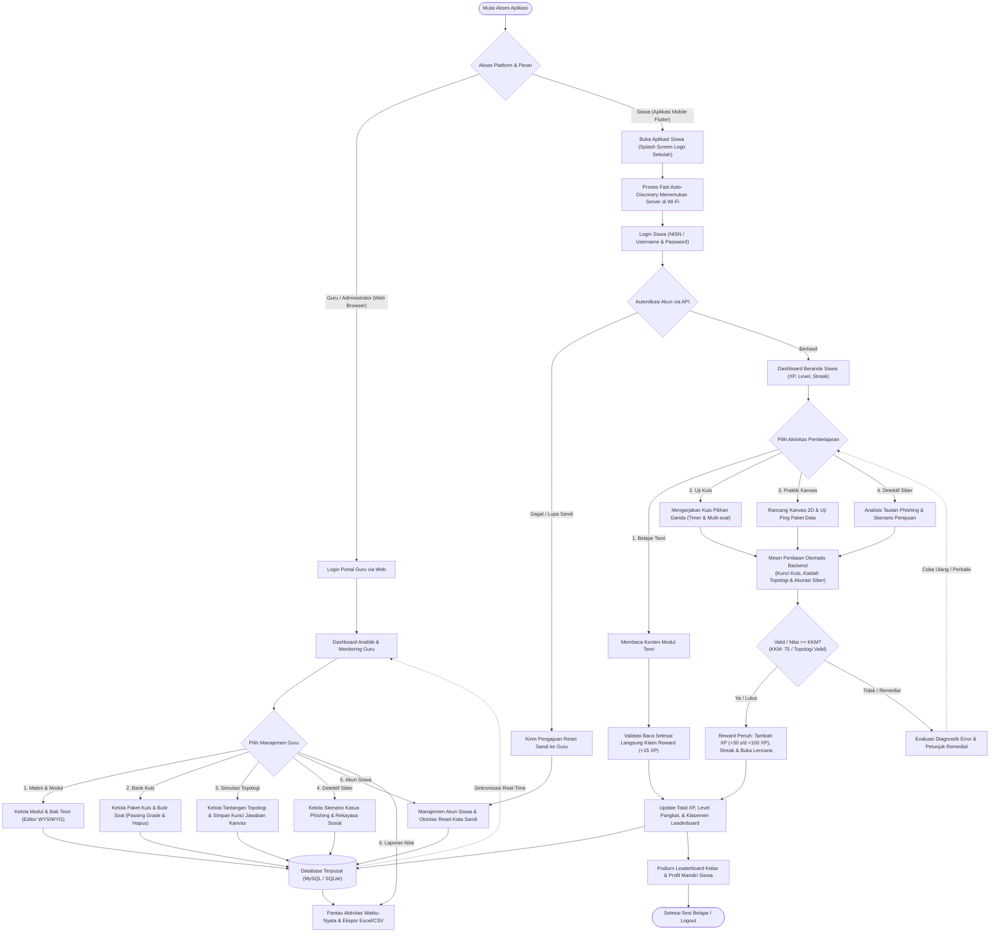
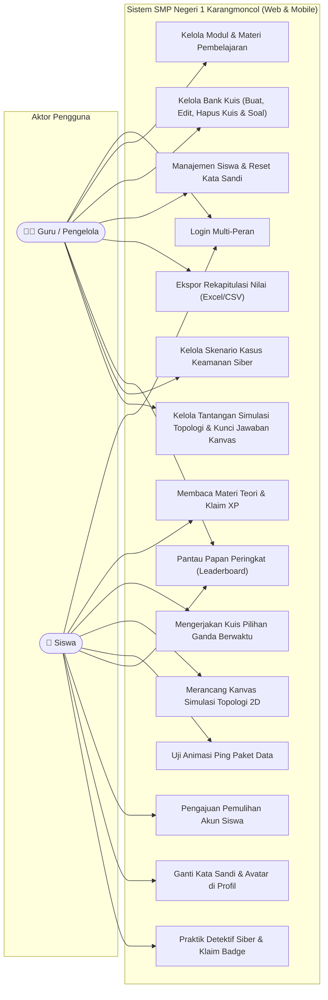
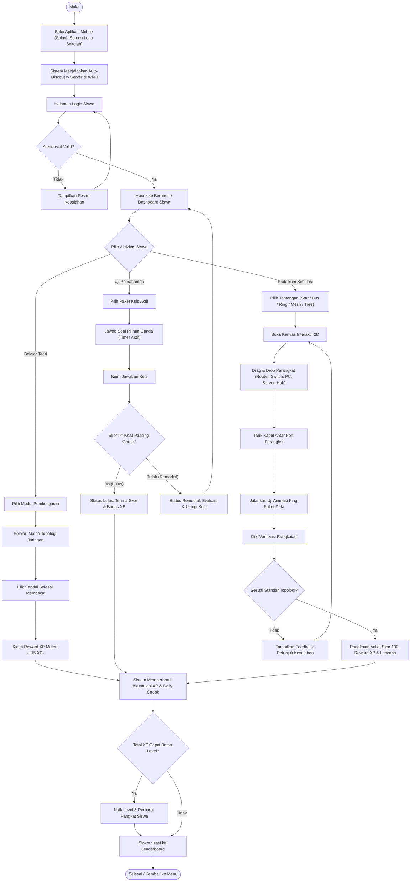
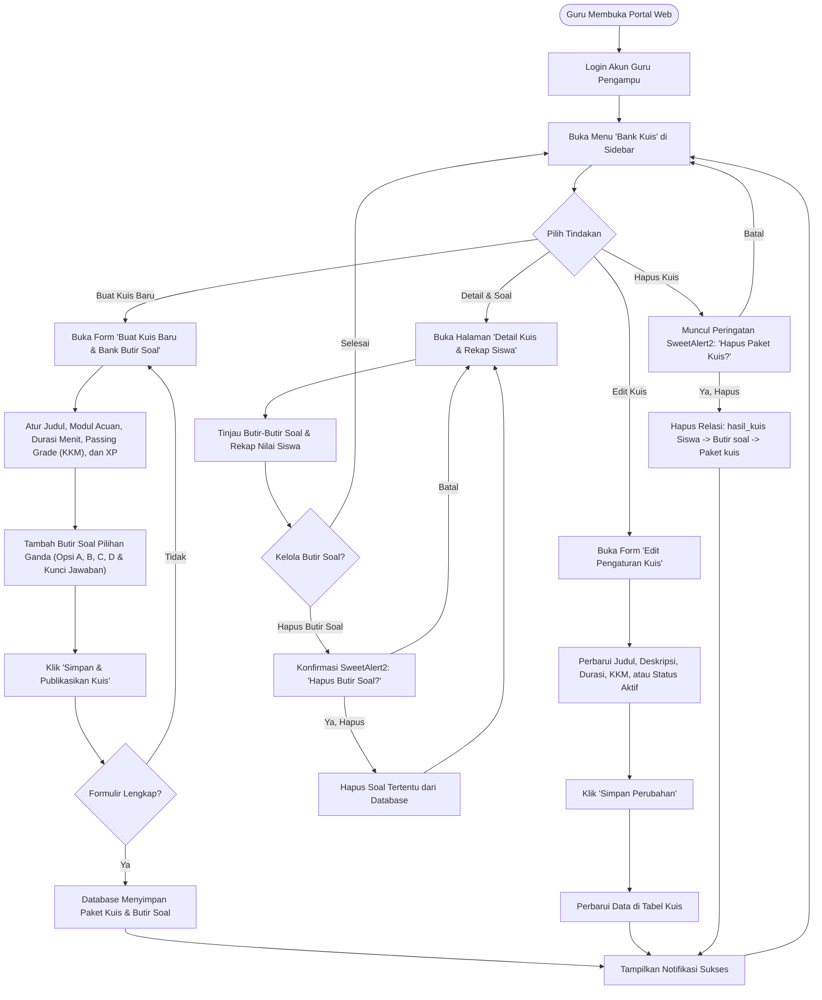
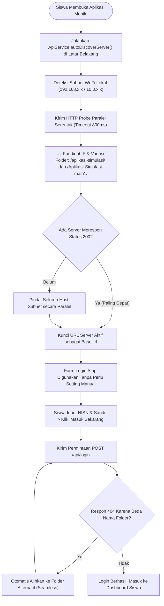
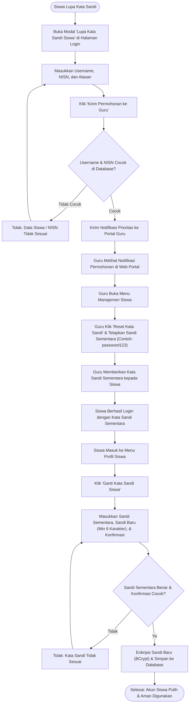
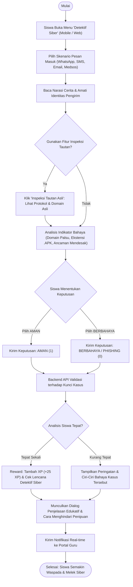

# 🌐 SMP Negeri 1 Karangmoncol — Media Pembelajaran & Simulasi Topologi Jaringan Komputer

> **Aplikasi Pembelajaran Jaringan Komputer & Simulasi Topologi Interaktif Berbasis Gamifikasi**  
> Diterapkan untuk pembelajaran mata pelajaran Informatika siswa di **SMP Negeri 1 Karangmoncol**, Kabupaten Purbalingga.

Aplikasi ini mengintegrasikan dua platform yang saling terhubung secara *real-time*:
1. 👨‍🏫 **Portal Guru / Pengelola (Web Desktop & Mobile Browser):** Manajemen silabus modul materi (WYSIWYG Quill.js), manajemen bank kuis (buat, edit, dan **hapus kuis beserta butir soal** dengan konfirmasi keamanan), pemantauan perakitan kanvas topologi, manajemen akun siswa, otoritas reset kata sandi, dan ekspor laporan nilai ke format Excel/CSV.
2. 📱 **Portal Siswa (Flutter Mobile & Desktop):** Pembelajaran interaktif dengan sistem gamifikasi (*Level, XP Reward, Lencana/Badges, Daily Streak*), **Kanvas Simulasi Topologi 2D Interaktif** dengan animasi pengiriman paket data (*Ping Packet Animation*), kuis berwaktu, tantangan Detektif Siber (*Anti-Phishing*), papan peringkat (*Leaderboard*), dan manajemen profil mandiri.
3. ⚡ **Backend RESTful API & Zero-Config Auto-Discovery:** Pure PHP MVC dengan *Dual Database System* (otomatis beralih ke SQLite jika MySQL XAMPP tidak aktif), dan teknologi **Fast Parallel Race Auto-Discovery** yang mendeteksi server laptop di jaringan Wi-Fi secara otomatis tanpa perlu mengetik alamat IP secara manual.

---

## 👥 Pengelola & Guru Pengampu Aplikasi

* **Bpk. Angzal Maolana, S.Pd** (Guru Pengampu / Administrator)
* **Ibu Hana Sifakhatin, S.Pd** (Guru Pengampu / Administrator)
* **Kunci Keamanan Master (Master Recovery Key):** `SMPN1-GURU-2026` *(Digunakan khusus oleh Guru Pengampu untuk pemulihan akun guru terproteksi)*

---

## 🔑 Akun Default Pengujian (Demo Credentials)

| Peran (Role) | Platform | Username / Alias | Password Default | Keterangan |
| :--- | :--- | :--- | :--- | :--- |
| **Guru Pengampu 1** | Web Browser | `angzal` *(alias: `guru1`)* | `password123` | Bpk. Angzal Maolana, S.Pd (Akses Penuh Portal Guru) |
| **Guru Pengampu 2** | Web Browser | `hana` *(alias: `guru2`)* | `password123` | Ibu Hana Sifakhatin, S.Pd (Akses Penuh Portal Guru) |
| **Siswa 1** | Mobile / Web | `siswa1` | `password123` | Ahmad Fauzi (Kelas VII A • Level 3 • 205 XP) |
| **Siswa 2** | Mobile / Web | `siswa2` | `password123` | Siti Rahmawati (Kelas VII A) |
| **Siswa 3** | Mobile / Web | `siswa3` | `password123` | Bambang Wicaksono (Kelas VII A) |

---

## 📊 Diagram Use Case & Flowchart Sistem

### 1. Flowchart Sistem Secara Umum (End-to-End High-Level Architecture)

Diagram alir berikut menggambarkan proses integrasi menyeluruh antara **Portal Guru (Web)**, **Portal Siswa (Mobile Flutter)**, **Backend RESTful API**, dan **Penyimpanan Database Terpusat**:



---

### 2. Diagram Use Case (Arsitektur Fungsional Multi-Peran)



---

### 3. Flowchart Alur Pembelajaran Siswa & Simulasi Topologi



---

### 4. Flowchart Manajemen Bank Kuis oleh Guru (Buat, Edit, Hapus)



---

### 4. Flowchart Koneksi Otomatis Mobile (Zero-Configuration Auto-Discovery)

---

### 5. Flowchart Koneksi Otomatis Mobile (Zero-Configuration Auto-Discovery)



---

### 6. Flowchart Alur Pemulihan & Ganti Kata Sandi Siswa



---

### 7. Flowchart Praktik Detektif Siber (Tantangan Keamanan Internet & Anti-Phishing)



---

## 💻 Kebutuhan Sistem (Prerequisites)

* **PHP:** Versi 8.1 ke atas (dengan ekstensi `pdo_mysql`, `pdo_sqlite`, `mbstring`, `fileinfo`, `gd`).
* **Web Server:** XAMPP (Apache & MySQL) atau PHP Built-in Server.
* **Flutter SDK:** Versi 3.19.0 ke atas (Channel stable) untuk aplikasi siswa di folder `mobile_siswa/`.
* **Koneksi Jaringan:** Jaringan Wi-Fi lokal atau Hotspot HP untuk menghubungkan HP siswa ke server laptop.

---

## 🚀 Panduan Menjalankan Backend & Portal Web Guru

### Opsi 1: Menggunakan XAMPP Apache (Paling Mudah)
1. Salin/tempatkan folder proyek ini di:
   ```text
   C:\xampp\htdocs\aplikasi-simulasi\
   ```
2. Buka **XAMPP Control Panel**, lalu klik **Start** pada modul **Apache** dan **MySQL**.
3. Import database (opsional, jika menggunakan MySQL):
   - Buka `http://localhost/phpmyadmin/`.
   - Buat database baru bernama `db_simulasi_topologi`.
   - Import file `database/schema.sql`.
   *(Catatan: Jika MySQL tidak dinyalakan, aplikasi secara cerdas akan langsung menggunakan database bawaan SQLite `database/db.sqlite` tanpa error).*
4. Buka browser dan akses:
   ```text
   http://localhost/aplikasi-simulasi/
   ```
5. Masuk dengan akun guru: `angzal` / `password123`.

### Opsi 2: Menggunakan PHP Built-in Server (Tanpa XAMPP)
Buka terminal / PowerShell di root proyek `aplikasi-simulasi`:
```powershell
php -S 0.0.0.0:8000 index.php
```
Akses melalui browser di: `http://localhost:8000/login`

---

## 📱 Panduan Menjalankan & Membangun Aplikasi Siswa (Flutter)

Kode aplikasi mobile berada di dalam folder: `c:\xampp\htdocs\aplikasi-simulasi\mobile_siswa\`

### 1. Persiapan Dependensi
Buka terminal di folder `mobile_siswa`:
```powershell
cd mobile_siswa
flutter pub get
```

---

### 2. Cara Build APK Siap Pasang ke HP (Tanpa Butuh Kabel USB)
Ini adalah cara yang **paling direkomendasikan** untuk menguji aplikasi di HP fisik:

* **Untuk Versi Uji Coba Cepat (Debug APK):**
  ```powershell
  flutter build apk --debug
  ```
  File APK terbentuk di:
  ```text
  mobile_siswa\build\app\outputs\flutter-apk\app-debug.apk
  ```

* **Untuk Versi Rilis Resmi Siswa (Lebih Ringan & Cepat):**
  ```powershell
  flutter build apk --release
  ```
  File APK terbentuk di:
  ```text
  mobile_siswa\build\app\outputs\flutter-apk\app-release.apk
  ```

**Cara Pasang di HP:**
1. Kirim file `.apk` tersebut ke HP lewat WhatsApp Web (sebagai Dokumen), Google Drive, atau Bluetooth.
2. Buka file di HP dan klik **Install**.
3. Buka aplikasi, masukkan username `siswa1` dan password `krisna123`, lalu login langsung!

---

### 3. Menjalankan Aplikasi di Komputer Lain / Laptop Teman
Jika proyek dijalankan di laptop lain dan dihubungkan ke HP siswa melalui Wi-Fi:

1. **Buka Port 80 Windows Firewall di Laptop:**
   Jalankan satu baris perintah ini di **PowerShell (Run as Administrator)** pada laptop penyedia server:
   ```powershell
   New-NetFirewallRule -DisplayName "XAMPP Apache Port 80" -Direction Inbound -LocalPort 80 -Protocol TCP -Action Allow
   ```
2. **Pilihan Sambungan Jaringan:**
   * **Opsi Wi-Fi:** Sambungkan HP dan Laptop ke Wi-Fi yang sama.
   * **Opsi Hotspot HP (Paling Stabil):** Nyalakan Hotspot Pribadi di HP, lalu sambungkan laptop ke Hotspot HP tersebut.
3. **Buka Aplikasi di HP:**
   Aplikasi mobile akan **otomatis memindai dan menemukan server laptop di Wi-Fi** tanpa perlu mengetik alamat IP secara manual!

---

## 🌟 Fitur Utama Aplikasi

### 👨‍🏫 1. Portal Guru (Web)
* **Dashboard Analitik:** Statistik siswa aktif, distribusi level, rata-rata skor kuis, dan pantauan aktivitas belajar waktu-nyata.
* **Manajemen Modul & Materi:** CMS lengkap dengan Rich-Text Editor WYSIWYG, integrasi gambar, dan bobot reward XP materi.
* **Bank Kuis & Soal:**
  - Pembuat paket kuis pilihan ganda dengan timer menit, passing grade KKM, dan reward XP.
  - **Fitur Hapus Kuis & Soal:** Dilengkapi dialog konfirmasi SweetAlert2 dan penghapusan relasi data (*cascading delete*).
* **Otoritas Reset Kata Sandi Siswa:** Guru berwenang mereset password siswa yang lupa akun secara instan dengan kata sandi sementara.
* **Permohonan Reset Siswa:** Notifikasi prioritas di dashboard ketika ada siswa yang mengajukan permohonan pemulihan akun.
* **Rekap Nilai & Ekspor Excel:** Rekapitulasi nilai otomatis per kelas dengan ekspor 1-klik ke format CSV/Excel (UTF-8).
* **Skenario Kasus Keamanan Siber:** Pembuat studi kasus phishing, indikator link palsu, dan analisis rekayasa sosial.

### 📱 2. Portal Siswa (Flutter Mobile & Desktop)
* **Zero-Configuration Auto-Discovery:** Menemukan server backend di jaringan lokal secara otomatis tanpa mengetik IP.
* **Kanvas Simulasi Topologi 2D:**
  - Drag-and-drop perangkat jaringan (*Router, Switch, Hub, Server, PC*).
  - Mode penarikan kabel dinamis antar port perangkat.
  - **Animasi Ping Data Packet:** Simulasi visual paket data bercahaya meluncur sepanjang kabel rangkaian.
  - Validasi otomatis topologi (*Star, Bus, Ring, Tree, Mesh*) via REST API dengan reward XP.
* **Gamifikasi Terpadu:**
  - Pangkat level (*Pemula Jaringan, Teknisi Muda, Arsitek Jaringan, Bintang Sekolah*).
  - XP Bar, Daily Streak 🔥, dan koleksi Lencana (*Badges*) interaktif.
* **Tantangan Detektif Siber (Anti-Phishing):** Praktik membedakan pesan resmi vs penipuan dengan fitur *Inspeksi Tautan Asli*.
* **Kuis Berwaktu:** Live countdown timer, navigasi nomor soal interaktif, dan evaluasi hasil langsung.
* **Papan Peringkat (Leaderboard):** Podium Top 3 (*Emas, Perak, Perunggu*) dan peringkat kelas real-time.
* **Keamanan Akun Mandiri:** Siswa dapat mengajukan pemulihan akun dan mengganti kata sandi mandiri di menu Profil.

---

## 📡 Ringkasan RESTful API Backend

| Method | Endpoint | Deskripsi |
| :--- | :--- | :--- |
| `GET`  | `/api/` | Pemeriksaan kesiapan server & status API (Health check) |
| `POST` | `/api/login` | Otentikasi login siswa via username / NISN & password |
| `POST` | `/api/request-reset-password` | Pengajuan permohonan pemulihan akun siswa ke Guru Pengampu |
| `POST` | `/api/profil/update-password` | Penggantian kata sandi mandiri oleh siswa yang telah login |
| `GET`  | `/api/modul?user_id={id}` | Mengambil seluruh silabus modul & materi pembelajaran |
| `GET`  | `/api/materi/{id}?user_id={id}` | Detail konten materi dan status kelulusan membaca |
| `POST` | `/api/materi/{id}/selesai` | Klaim reward XP selesai membaca materi |
| `GET`  | `/api/kuis?user_id={id}` | Daftar paket kuis aktif |
| `GET`  | `/api/kuis/{id}` | Butir-butir soal kuis evaluasi |
| `POST` | `/api/kuis/{id}/submit` | Pengiriman jawaban kuis dan perhitungan skor |
| `GET`  | `/api/simulasi?user_id={id}` | Daftar tantangan simulasi topologi jaringan |
| `GET`  | `/api/simulasi/{id}` | Detail konfigurasi perangkat & target kunci topologi |
| `POST` | `/api/simulasi/{id}/submit` | Validasi kanvas 2D topologi dan pemberian XP |
| `GET`  | `/api/kasus-keamanan?user_id={id}` | Daftar tantangan studi kasus keamanan siber (WhatsApp, SMS, Email, Medsos) |
| `GET`  | `/api/kasus-keamanan/{id}` | Detail skenario kasus keamanan siber tertentu |
| `POST` | `/api/kasus-keamanan/{id}/submit` | Evaluasi keputusan siswa (Aman vs Berbahaya), reward XP, & badge |
| `GET`  | `/api/profil?user_id={id}` | Mengambil data profil siswa, badges, riwayat XP, dan level |
| `POST` | `/api/profil/avatar` | Pembaruan foto profil atau pemilihan karakter avatar |
| `GET`  | `/api/leaderboard` | Papan peringkat ranking siswa kelas |

---

## 📂 Struktur Direktori Proyek

```text
c:\xampp\htdocs\aplikasi-simulasi\
├── app/
│   ├── controllers/
│   │   ├── ApiController.php         # REST API Mobile Siswa (Auth, Kuis, Modul, Simulasi, Siber)
│   │   ├── AuthController.php        # Otentikasi Multi-role & Reset Password Guru/Siswa
│   │   ├── GuruController.php        # Portal Guru (Modul, Kuis, Siswa, Rekap, Hapus Kuis & Soal)
│   │   └── SiswaController.php       # Portal Web Siswa & Update Password
│   ├── helpers/
│   │   ├── functions.php             # Gamifikasi XP, Level, Badges, Notifikasi
│   │   ├── response.php              # JSON Response Formatter
│   │   └── session.php               # Session & Keamanan CSRF
│   └── models/
│       ├── UserModel.php
│       ├── ModulModel.php
│       ├── KuisModel.php
│       └── SimulasiModel.php
├── config/
│   ├── app.php                       # Konfigurasi Master Recovery Key & Dynamic Base URL
│   └── database.php                  # Koneksi PDO MySQL & SQLite Auto-fallback
├── database/
│   ├── schema.sql                    # Skema Database MySQL
│   └── db.sqlite                     # Database SQLite Bawaan Siap Pakai
├── mobile_siswa/                     # PROYEK FLUTTER SISWA
│   ├── lib/
│   │   ├── models/
│   │   │   └── user_model.dart       # State Manajemen Pengguna Siswa
│   │   ├── screens/
│   │   │   ├── splash_screen.dart    # Splash Screen Logo Sekolah & Background Discovery
│   │   │   ├── dashboard_screen.dart # Beranda Siswa & Pilihan Navigasi
│   │   │   ├── login_screen.dart     # Login Bersih (Zero-Config) & Lupa Password Modal
│   │   │   ├── materi_screen.dart    # Pembaca Materi & Klaim XP
│   │   │   ├── kuis_screen.dart      # Kuis Berwaktu & Soal Interaktif
│   │   │   ├── simulasi_canvas_screen.dart # Kanvas 2D & Animasi Ping Paket Data
│   │   │   ├── simulasi_list_screen.dart   # Daftar Tantangan Topologi
│   │   │   ├── studi_kasus_screen.dart     # Tantangan Detektif Siber & Anti-Phishing
│   │   │   ├── leaderboard_screen.dart     # Podium & Peringkat Siswa
│   │   │   ├── notifikasi_screen.dart      # Notifikasi Siswa
│   │   │   └── profil_screen.dart          # Profil, Badges, Ganti Kata Sandi & Avatar
│   │   ├── services/
│   │   │   └── api_service.dart      # Fast Parallel Race Auto-Discovery & REST Client
│   │   └── main.dart                 # Entry Point Aplikasi Flutter
│   └── pubspec.yaml
├── public/                           # Aset Publik (Gambar, Logo, CSS, JS, Avatars)
├── views/                            # Template Tampilan Web Guru, Siswa, & Auth
├── .htaccess                         # URL Rewriting Dinamis untuk Apache XAMPP
├── .gitignore                        # Konfigurasi Pengecualian Berkas Git
├── index.php                         # Router Utama Aplikasi
└── README.md                         # Dokumentasi Lengkap Proyek
```

---
*SMP Negeri 1 Karangmoncol • Media Pembelajaran Informatika Interaktif • Berbasis Gamifikasi & Simulasi Topologi Jaringan.*
