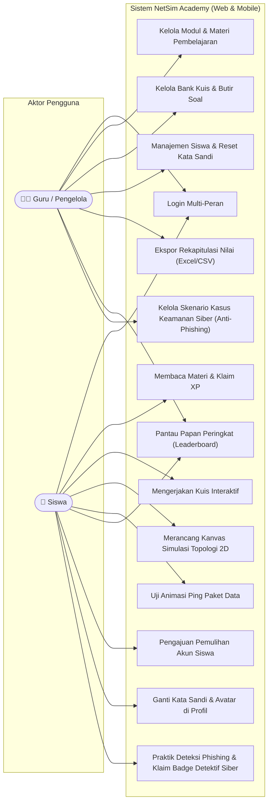
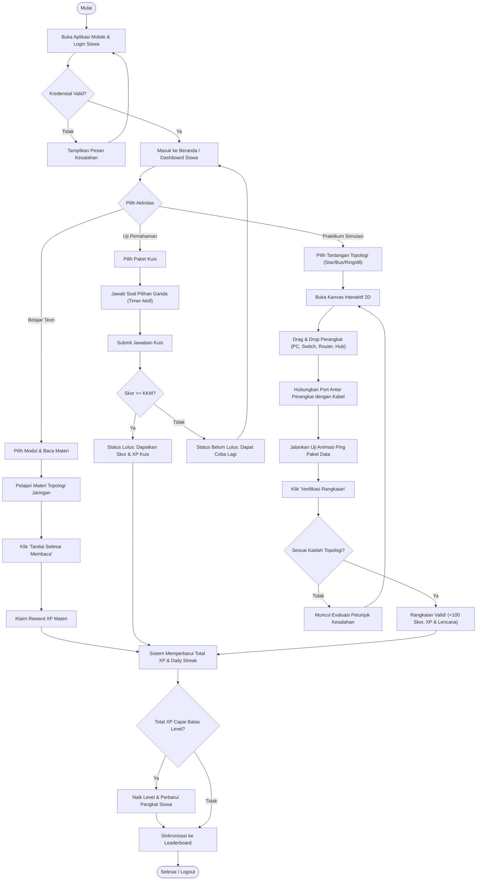
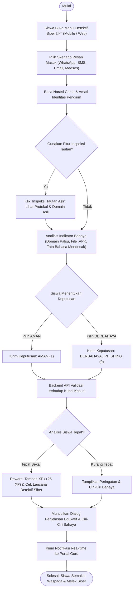

# 🌐 NetSim Academy — Media Pembelajaran & Simulasi Topologi Jaringan Komputer

> **Aplikasi Pembelajaran Jaringan Komputer & Simulasi Topologi Interaktif Berbasis Gamifikasi**  
> Diterapkan untuk pembelajaran Informatika siswa di **SMP Negeri 1 Karangmoncol**, Kabupaten Purbalingga.

Aplikasi ini mengintegrasikan dua platform yang saling terhubung secara *real-time*:
1. 👨‍🏫 **Portal Guru / Pengelola (Web Desktop/Browser):** Manajemen modul materi (WYSIWYG Quill.js), bank kuis pilihan ganda berwaktu, otoritas keamanan & reset password siswa, pemantauan aktivitas, dan ekspor laporan nilai ke Excel.
2. 📱 **Portal Siswa (Flutter Mobile & Desktop):** Pembelajaran interaktif dengan sistem gamifikasi (*Level, XP Reward, Lencana/Badges, Daily Streak*), **Kanvas Simulasi Topologi 2D Interaktif** dengan animasi pengiriman paket data (*Ping Packet Animation*), kuis berwaktu, papan peringkat (*Leaderboard*), dan manajemen profil mandiri.
3. ⚡ **Backend RESTful API:** Pure PHP MVC dengan *Dual Database System* (otomatis beralih ke SQLite jika MySQL XAMPP tidak menyala).

---

## 👥 Pengelola & Guru Pengampu Aplikasi

* **Bpk. Angzal Maolana, S.Pd** (Guru Pengampu / Administrator)
* **Ibu Hana Sifakhatin, S.Pd** (Guru Pengampu / Administrator)
* **Kunci Keamanan Master (Master Recovery Key):** `SMPN1-GURU-2026` *(Digunakan khusus oleh Guru Pengampu untuk pemulihan akun guru terproteksi)*

---

## 🔑 Akun Default Pengujian (Demo Credentials)

| Peran (Role) | Platform | Username / Alias | Password Default | Keterangan |
| :--- | :--- | :--- | :--- | :--- |
| **Guru Pengampu 1** | Web Browser | `angzal` *(alias: `guru1`)* | `password123` | Bpk. Angzal Maolana, S.Pd (Akses Penuh Portal Guru) |
| **Guru Pengampu 2** | Web Browser | `hana` *(alias: `guru2`)* | `password123` | Ibu Hana Sifakhatin, S.Pd (Akses Penuh Portal Guru) |
| **Siswa 1** | Mobile / Web | `siswa1` | `password123` | Ahmad Fauzi (Kelas VII A • Level 3 • 205 XP) |
| **Siswa 2** | Mobile / Web | `siswa2` | `password123` | Siti Rahmawati (Kelas VII A) |
| **Siswa 3** | Mobile / Web | `siswa3` | `password123` | Bambang Wicaksono (Kelas VII A) |

---

## 📊 Diagram Use Case & Flowchart Sistem

### 1. Diagram Use Case (Arsitektur Fungsional Multi-Peran)



### 2. Flowchart Alur Pembelajaran Siswa & Simulasi Topologi



### 3. Flowchart Alur Pemulihan & Ganti Kata Sandi Siswa


### 3. Flowchart Praktik Detektif Siber (Tantangan Keamanan Internet & Anti-Phishing)



---

## 💻 Kebutuhan Sistem (Prerequisites)

* **PHP:** Versi 8.1 ke atas (dengan ekstensi `pdo_mysql`, `pdo_sqlite`, `mbstring`, `fileinfo`, `gd`).
* **Web Server:** XAMPP (Apache & MySQL) atau PHP Built-in Server.
* **Flutter SDK:** Versi 3.19.0 ke atas (Channel stable) untuk aplikasi siswa di folder `mobile_siswa/`.
* **Koneksi Jaringan:** Diperlukan jaringan Wi-Fi lokal atau koneksi internet untuk sinkronisasi HP ke Backend.

---

## 🚀 Panduan Menjalankan Backend & Portal Web Guru

### Opsi 1: Menggunakan XAMPP Apache (Paling Mudah)
1. Salin/tempatkan folder proyek ini di:
   ```text
   C:\xampp\htdocs\aplikasi-simulasi\
   ```
2. Buka **XAMPP Control Panel**, lalu klik **Start** pada modul **Apache** dan **MySQL**.
3. Import database (opsional, jika menggunakan MySQL):
   - Buka `http://localhost/phpmyadmin/`.
   - Buat database baru bernama `db_simulasi_topologi`.
   - Import file `database/schema.sql`.
   *(Catatan: Jika MySQL tidak dinyalakan, aplikasi secara cerdas akan langsung menggunakan database bawaan SQLite `database/db.sqlite` tanpa error).*
4. Buka browser dan akses:
   ```text
   http://localhost/aplikasi-simulasi/
   ```
5. Masuk dengan akun guru: `angzal` / `password123`.

### Opsi 2: Menggunakan PHP Built-in Server (Tanpa XAMPP)
Buka terminal / PowerShell di root proyek `aplikasi-simulasi`:
```powershell
php -S 0.0.0.0:8000 index.php
```
Akses melalui browser di: `http://localhost:8000/login`

---

## 📱 Panduan Menjalankan Aplikasi Mobile Siswa (Flutter)

Kode aplikasi mobile berada di dalam folder: `c:\xampp\htdocs\aplikasi-simulasi\mobile_siswa\`

### 1. Persiapan Dependensi
Buka terminal di folder `mobile_siswa`:
```powershell
cd mobile_siswa
flutter pub get
```

### 2. Pilihan Menjalankan Aplikasi:

#### A. Di Laptop (Windows Desktop)
```powershell
flutter run -d windows
```

#### B. Di Google Chrome (Web Browser)
```powershell
flutter run -d chrome
```

#### C. Di Android Emulator
1. Nyalakan emulator dari Android Studio.
2. Jalankan:
   ```powershell
   flutter run
   ```
   *(Aplikasi otomatis menggunakan alamat loopback emulator `http://10.0.2.2/aplikasi-simulasi/api`).*

#### D. Di HP Fisik Android (Menggunakan Kabel USB)
1. Aktifkan **Opsi Pengembang (Developer Options)** dan **Debugging USB** di HP Android Anda.
2. Hubungkan HP ke laptop menggunakan kabel data USB dan pilih *"Izinkan Debugging USB"*.
3. **Penting:** Pastikan HP dan laptop terhubung ke **satu jaringan Wi-Fi yang sama**.
4. Cek apakah HP terdeteksi:
   ```powershell
   flutter devices
   ```
5. Jalankan aplikasi ke HP:
   ```powershell
   flutter run
   ```

#### E. Build Menjadi Berkas APK (Untuk Di-install Mandiri di HP)
Jika ingin membagikan aplikasi ke HP siswa tanpa kabel:
```powershell
flutter build apk --debug
```
*(Atau `flutter build apk --release` untuk versi rilis).*
File APK siap pakai berada di:
```text
mobile_siswa/build/app/outputs/flutter-apk/app-debug.apk
```
Kirim file APK tersebut ke HP siswa dan pasang (*Install*).

---

## ⚙️ Konfigurasi URL API Backend pada Aplikasi Mobile

Aplikasi mobile telah dilengkapi tombol **Pengaturan Server** (ikon link di pojok atas formulir login) dengan fitur deteksi otomatis dan preset siap pakai:

| Target Uji Coba | URL API Backend yang Digunakan |
| :--- | :--- |
| **Windows Desktop / Chrome** | `http://localhost/aplikasi-simulasi/api` |
| **Android Emulator** | `http://10.0.2.2/aplikasi-simulasi/api` |
| **HP Android Fisik (Wi-Fi Lokal)** | `http://[IP-Komputer-Anda]/aplikasi-simulasi/api` *(Contoh: `http://192.168.0.193/aplikasi-simulasi/api`)* |
| **Server Hosting Online** | `https://domain-anda.com/api` |

---

## 🌐 Menghubungkan ke Hosting Online (Production)

Jika backend di-hosting di server internet publik (cPanel / VPS):
1. Upload seluruh file backend PHP ke hosting dan import database MySQL.
2. Sesuaikan konfigurasi koneksi di `config/database.php` dan `config/app.php`.
3. Buka file [api_service.dart](mobile_siswa/lib/services/api_service.dart#L10), lalu ganti `baseUrl`:
   ```dart
   static String baseUrl = 'https://domain-anda.com/api';
   ```
4. Build APK rilis dengan `flutter build apk --release`.
5. Siswa dapat menggunakan aplikasi dari mana saja menggunakan koneksi internet/kuota data seluler tanpa harus terhubung ke Wi-Fi laptop.

---

## 📤 Panduan Push Proyek ke GitHub

Proyek ini telah dilengkapi file `.gitignore` terstandar agar berkas binari `build/`, `.dart_tool/`, dan log sementara tidak ikut ter-upload.

Jalankan perintah berikut di PowerShell pada root direktori:

```powershell
# 1. Masuk ke folder root aplikasi
cd c:\xampp\htdocs\aplikasi-simulasi

# 2. Inisialisasi Git repository (jika belum)
git init

# 3. Masukkan seluruh file ke staging area
git add .

# 4. Commit perubahan
git commit -m "Initial commit: Aplikasi Pembelajaran & Simulasi Topologi Jaringan SMPN 1 Karangmoncol"

# 5. Ubah branch utama menjadi main
git branch -M main

# 6. Hubungkan ke repository GitHub Anda (ganti URL di bawah dengan URL repo Anda)
git remote add origin https://github.com/USERNAME-ANDA/NAMA-REPO-ANDA.git

# 7. Push source code ke GitHub
git push -u origin main
```

---

## 🌟 Fitur Utama Aplikasi

### 👨‍🏫 1. Portal Guru (Web)
* **Dashboard Analitik:** Statistik siswa aktif, kelas VII, rata-rata skor kuis, dan aktivitas belajar.
* **Manajemen Modul & Materi:** CMS lengkap dengan Rich-Text Editor WYSIWYG, gambar topologi, dan bobot XP materi.
* **Bank Kuis & Soal:** Pembuat kuis pilihan ganda dengan durasi menit, passing grade (KKM), dan pembahasan.
* **Otoritas Reset Kata Sandi Siswa:** Guru berwenang mereset password siswa yang lupa akun secara instan dengan kata sandi sementara.
* **Permohonan Reset Siswa:** Notifikasi masuk ke guru ketika ada siswa yang mengajukan permohonan pemulihan akun.
* **Rekap Nilai & Ekspor Excel:** Rekapitulasi nilai otomatis per kelas dengan ekspor 1-klik ke format CSV/Excel (UTF-8).

### 📱 2. Portal Siswa (Flutter Mobile & Desktop)
* **Kanvas Simulasi Topologi 2D:**
  - Drag-and-drop perangkat jaringan (*Router, Switch, Hub, Server, PC*).
  - Mode penarikan kabel dinamis antar port perangkat.
  - **Animasi Ping Data Packet:** Simulasi visual paket data bercahaya meluncur sepanjang kabel.
  - Validasi otomatis topologi (*Star, Bus, Ring, Tree, Mesh*) via REST API dengan reward XP.
* **Gamifikasi Terpadu:**
  - Pangkat level (*Pemula Jaringan, Teknisi Muda, Arsitek Jaringan, Juara NetSim*).
  - XP Bar, Daily Streak 🔥, dan koleksi Lencana (*Badges*) interaktif.
* **Kuis Berwaktu:** Live countdown timer, navigasi nomor soal interaktif, dan evaluasi hasil langsung.
* **Papan Peringkat (Leaderboard):** Podium Top 3 (*Emas, Perak, Perunggu*) dan peringkat kelas real-time.
* **Keamanan Akun Mandiri:** Siswa dapat mengganti kata sandi sementara dari guru di menu **Profil Siswa**.
* **Kustomisasi Profil:** Pilihan koleksi avatar karakter atau unggah foto profil langsung dari kamera/galeri.

---

## 📡 Ringkasan RESTful API Backend

| Method | Endpoint | Deskripsi |
| :--- | :--- | :--- |
| `POST` | `/api/login` | Otentikasi login siswa via username / NISN / email & password |
| `POST` | `/api/request-reset-password` | Pengajuan permohonan pemulihan akun siswa ke Guru Pengampu |
| `POST` | `/api/profil/update-password` | Penggantian kata sandi mandiri oleh siswa yang telah login |
| `GET`  | `/api/modul?user_id={id}` | Mengambil seluruh silabus modul & materi pembelajaran |
| `GET`  | `/api/materi/{id}?user_id={id}` | Detail konten materi dan status kelulusan membaca |
| `POST` | `/api/materi/{id}/selesai` | Klaim reward XP selesai membaca materi |
| `GET`  | `/api/kuis?user_id={id}` | Daftar paket kuis aktif |
| `GET`  | `/api/kuis/{id}` | Butir-butir soal kuis evaluasi |
| `POST` | `/api/kuis/{id}/submit` | Pengiriman jawaban kuis dan perhitungan skor |
| `GET`  | `/api/simulasi?user_id={id}` | Daftar tantangan simulasi topologi jaringan |
| `POST` | `/api/simulasi/{id}/submit` | Validasi kanvas 2D topologi dan pemberian XP |
| `GET`  | `/api/kasus-keamanan?user_id={id}` | Daftar tantangan studi kasus keamanan siber (WhatsApp, SMS, Email, Medsos) |
| `GET`  | `/api/kasus-keamanan/{id}` | Detail skenario kasus keamanan siber tertentu |
| `POST` | `/api/kasus-keamanan/{id}/submit` | Evaluasi keputusan siswa (Aman vs Berbahaya), reward XP, & badge |
| `GET`  | `/api/profil?user_id={id}` | Mengambil data profil siswa, badges, riwayat XP, dan level |
| `POST` | `/api/profil/avatar` | Pembaruan foto profil atau pemilihan karakter avatar |
| `GET`  | `/api/leaderboard` | Papan peringkat ranking siswa kelas |

---

## 📂 Struktur Direktori Proyek

```text
c:\xampp\htdocs\aplikasi-simulasi\
├── app/
│   ├── controllers/
│   │   ├── ApiController.php         # REST API Mobile Siswa
│   │   ├── AuthController.php        # Otentikasi Multi-role & Reset Password Guru/Siswa
│   │   ├── GuruController.php        # Portal Guru (Modul, Kuis, Siswa, Rekap)
│   │   └── SiswaController.php       # Portal Web Siswa & Update Password
│   ├── helpers/
│   │   ├── functions.php             # Gamifikasi XP, Level, Badges, Notifikasi
│   │   ├── response.php              # JSON Response Formatter
│   │   └── session.php               # Session & Keamanan CSRF
│   └── models/
│       ├── UserModel.php
│       ├── ModulModel.php
│       ├── KuisModel.php
│       └── SimulasiModel.php
├── config/
│   ├── app.php                       # Konfigurasi Master Recovery Key & Base URL
│   └── database.php                  # Koneksi PDO MySQL & SQLite Auto-fallback
├── database/
│   ├── schema.sql                    # Skema Database MySQL
│   └── db.sqlite                     # Database SQLite Bawaan Siap Pakai
├── mobile_siswa/                     # PROYEK FLUTTER SISWA
│   ├── lib/
│   │   ├── models/
│   │   │   └── user_model.dart       # State Manajemen Pengguna Siswa
│   │   ├── screens/
│   │   │   ├── dashboard_screen.dart # Beranda Siswa
│   │   │   ├── login_screen.dart     # Login & Bottom Sheet Lupa Password
│   │   │   ├── materi_screen.dart    # Pembaca Materi & Klaim XP
│   │   │   ├── kuis_screen.dart      # Kuis Berwaktu & Soal Interaktif
│   │   │   ├── simulasi_canvas_screen.dart # Kanvas 2D & Animasi Ping
│   │   │   ├── simulasi_list_screen.dart   # Daftar Tantangan Topologi
│   │   │   ├── studi_kasus_screen.dart     # Tantangan Detektif Siber & Anti-Phishing
│   │   │   ├── leaderboard_screen.dart     # Podium & Peringkat Siswa
│   │   │   ├── notifikasi_screen.dart      # Notifikasi Siswa
│   │   │   └── profil_screen.dart          # Profil, Badges, Ganti Kata Sandi & Avatar
│   │   ├── services/
│   │   │   └── api_service.dart      # HTTP Client REST API & Auto-Fallback Server
│   │   └── main.dart                 # Entry Point Aplikasi Flutter
│   └── pubspec.yaml
├── public/                           # Aset Publik (Gambar, CSS, JS, Avatars)
├── views/                            # Template Tampilan Web Guru, Siswa, & Auth
├── .gitignore                        # Konfigurasi Pengecualian Berkas Git
├── index.php                         # Router Utama Aplikasi
└── README.md                         # Dokumentasi Proyek
```

---
*Dikembangkan dengan penuh dedikasi untuk inovasi pembelajaran Informatika di SMP Negeri 1 Karangmoncol.*
